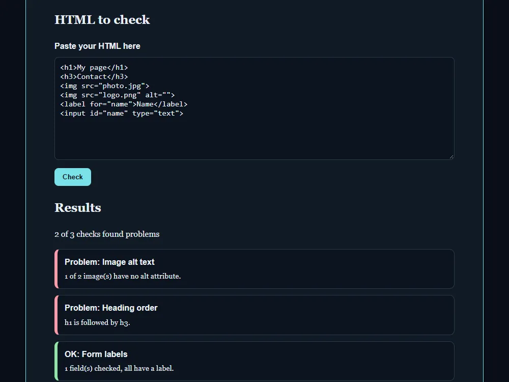

# Accessibility checker

[Live demo](https://wjohansson94.github.io/portfolio/a11y.html) · [Back to the main README](../../README.md)

**Authorship:** AI-generated, typed by hand. The code was provided step by step by an AI assistant and I typed it in by hand in VS Code, then learned from it.

## What it does
Paste a piece of HTML and press Check. The page reports three simple checks: images without an `alt` attribute, skipped heading levels (and whether there is exactly one `h1`), and form fields without a label. It is a small learning tool with three rules only. It does not replace axe, Lighthouse or manual testing.

## How it's built
- Files: `a11y.html`, `css/a11y.css`, `js/a11y.js` (plus the shared `js/theme.js` and `css/theme.css`)
- Plain HTML, CSS and JavaScript, no libraries, no network requests, nothing stored in `localStorage`
- The pasted text is parsed with `DOMParser`, so its scripts are not run
- `querySelectorAll` finds the elements; the result list is spread into an array so array methods can be used
- Images are checked with `hasAttribute("alt")`, because `alt=""` is valid for decorative images
- Form fields count as labelled if they have a wrapping `label`, a `label` with a matching `for`/`id` (the id goes through `CSS.escape`), or `aria-label`/`aria-labelledby`
- Results are built with `createElement` and `textContent` (not `innerHTML`), and each one starts with "OK:" or "Problem:"

## Run it locally
No install or build. Open `a11y.html` in a browser, or serve the repository folder, for example `python -m http.server` (or `npx serve`), and open `http://localhost:8000/a11y.html`. No internet connection is needed.

## What I understood
How `DOMParser` turns pasted text into a document without running its scripts, how `querySelectorAll` plus spreading the list into an array lets me use `filter`, why `hasAttribute("alt")` is used instead of checking the value, and why results use `textContent` instead of `innerHTML`. Each result says "OK:" or "Problem:", so colour is not the only signal.

## What was tricky to understand
A form field can be labelled in several ways (a wrapping label, `label for`/`id`, `aria-label` or `aria-labelledby`), and `CSS.escape` is needed when an id is put into a selector. Heading order was also tricky: skipping a level (for example `h1` followed by `h3`) is a problem, but going back up is fine.

## Accessibility notes
The textarea has a label, the status text is a `role="status"` region so changes are announced, and results use text ("OK:"/"Problem:") in addition to colour. The page works with both the dark and light theme.

## Tests
No automated tests for this project.
