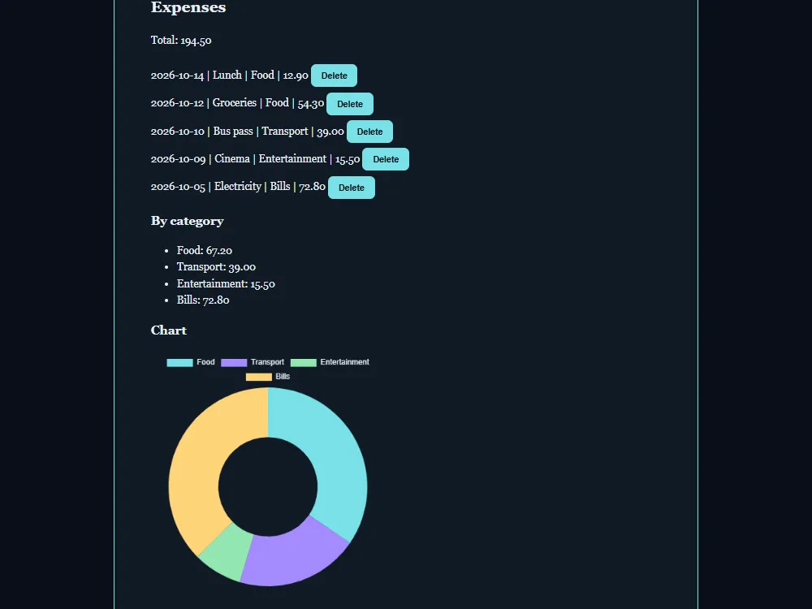

# Expense tracker

[Live demo](https://wjohansson94.github.io/portfolio/expenses.html) · [Back to the main README](../../README.md)

**Authorship:** AI-generated, typed by hand. The code was provided step by step by an AI assistant and I typed it in by hand in VS Code, then fixed my own typos and bugs and learned from them.

## What it does
Add an expense (description, amount, category and date), delete single expenses, and see the total, totals per category and a doughnut chart of spending per category.

## How it's built
- Files: `expenses.html`, `expenses.css`, `expenses.js` (plus the shared `theme.js` and `theme.css`) and `vendor/chart.umd.js`
- Plain HTML, CSS and JavaScript, plus [Chart.js](https://www.chartjs.org/) 4.4.7, my first library. It is vendored in `vendor/` (MIT licence included), so no CDN or internet connection is needed
- Totals use `reduce`; deleting uses `filter`; list items are built with `textContent`
- Storage: expenses are saved in `localStorage` under `expenses`, read with `try/catch`
- The chart legend colour is set again when the theme changes, because Chart.js draws on a canvas

## Run it locally
No install or build. Serve the repository folder, for example `python -m http.server` (or `npx serve`), and open `http://localhost:8000/expenses.html`.

## What I understood
How expenses are saved in `localStorage`, how `reduce` gives the totals and `filter` deletes an item, how list items are built with `textContent`, and how a doughnut chart is drawn with Chart.js.

## What was tricky to understand
The chart has to update after every change and follow the light and dark theme. Chart.js draws on a canvas, so the legend colour has to be set again when the theme changes.

## Accessibility notes
Labelled form fields, native validation (`required`, `min`), a per-item Delete button label and a `role="status"` total.

## Tests
No automated tests for this project.
