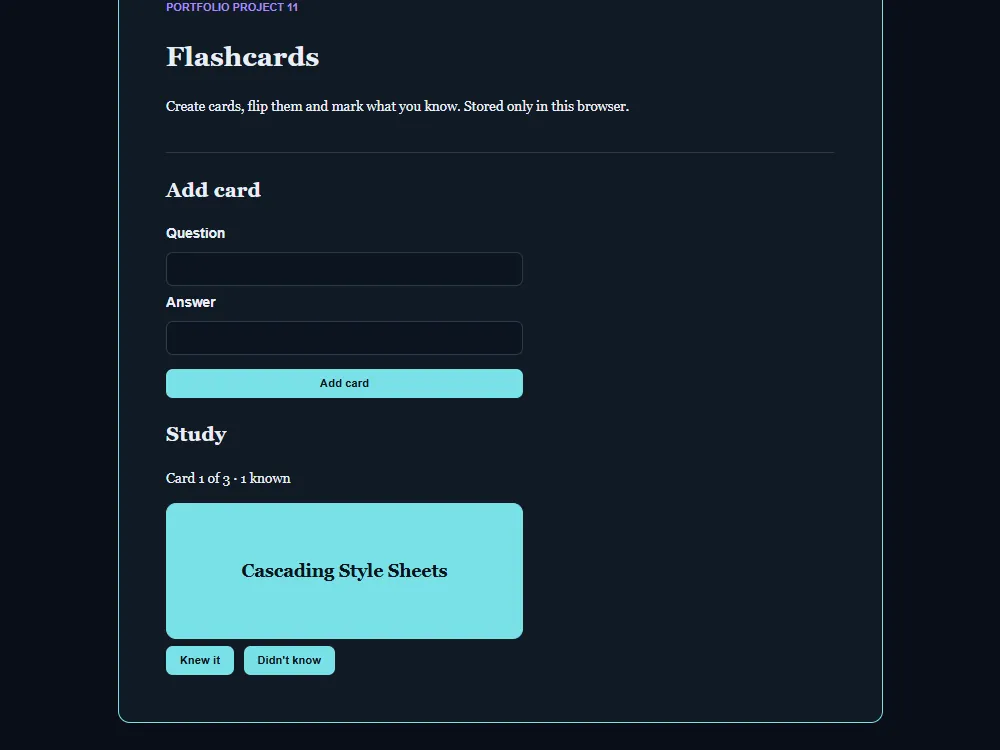

# Flashcards

[Live demo](https://wjohansson94.github.io/portfolio/flashcards.html) · [Back to the main README](../../README.md)

**Authorship:** AI-generated, typed by hand. The code was provided step by step by an AI assistant and I typed it in by hand in VS Code, then fixed my own typos and bugs and learned from them.

## What it does
Create question and answer cards, flip a card to see the answer, mark it "Knew it" or "Didn't know" and move to the next card. The list loops around after the last card.

## How it's built
- Files: `flashcards.html`, `css/flashcards.css`, `js/flashcards.js` (plus the shared `js/theme.js` and `css/theme.css`)
- Plain HTML, CSS and JavaScript, no libraries
- Storage: cards are saved in `localStorage` under `flashcards`; loaded data is checked with `isValidCard` and `filter` inside `try/catch`
- A card is flipped with a true/false variable, the `%` operator loops to the next card, and one render function redraws everything after each change

## Run it locally
No install or build. Serve the repository folder, for example `python -m http.server` (or `npx serve`), and open `http://localhost:8000/flashcards.html`.

## What I understood
How cards are saved in `localStorage` and checked before use (`isValidCard` with `filter`), how a card is flipped with a true/false variable, how the `%` operator loops to the next card, and how labelled inputs, disabled buttons and `aria-live` text for the counter help accessibility.

## What was tricky to understand
Keeping the card number, the flipped state and the saved list in sync, so that one render function redraws everything after each change.

## Accessibility notes
Labelled inputs, buttons disabled when there are no cards, an `aria-live` counter, and reduced motion respected.

## Tests
No automated tests for this project.
