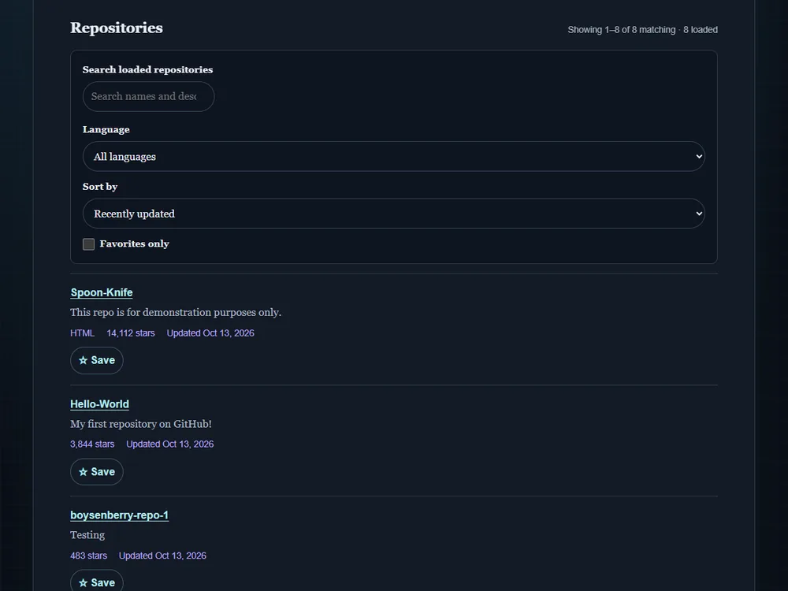

# GitHub repository explorer

[Live demo](https://wjohansson94.github.io/portfolio/github.html) · [Back to the main README](../../README.md)

**Authorship:** Built with AI. Made with a lot of help from an AI assistant (GitHub Copilot). I read and tested the code to understand it, but I did not write it unaided.

## What it does
Searches for a public GitHub user, shows profile details, loads their repositories in pages, filters by language, sorts, and lets you save favourite repositories. It shows loading, empty, timeout, network, not-found and rate-limit states.

## How it's built
- Files: `github.html`, `css/github.css`, `js/github.js` (plus the shared `js/theme.js` and `css/theme.css`)
- Plain HTML, CSS and JavaScript with `fetch` and async/await
- Data: the public GitHub REST API (`api.github.com/users/...`), without a token, so GitHub's rate limits apply
- Requests time out after 15 seconds, and an older response is ignored when a newer search has started
- Storage: favourites in `localStorage`, saved per username

## Run it locally
No install or build. Serve the repository folder, for example `python -m http.server` (or `npx serve`), and open `http://localhost:8000/github.html`. An internet connection is needed for the GitHub API.

## What I understood
How data is fetched from a public REST API with async/await, how loading, not-found and rate-limit messages are shown, and how results are paged.

## What was tricky to understand
Slow or repeated searches. Requests time out after 15 seconds, and an older response is ignored when a newer search has started.

## Accessibility notes
Labelled controls and status messages for loading, errors and results.

## Tests
No automated tests for this project.
