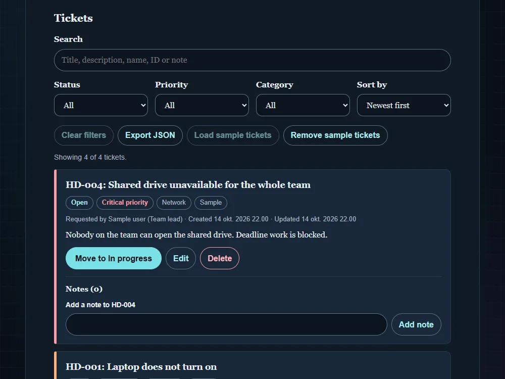

# Helpdesk tickets

[Live demo](https://wjohansson94.github.io/portfolio/helpdesk.html) · [Back to the main README](../../README.md)

**Authorship:** Built with AI. Made with a lot of help from an AI assistant (GitHub Copilot). I read and tested the code to understand it, but I did not write it unaided.

## What it does
A ticket tracker modelled on how IT help desks work. You can create, edit and delete tickets, move them through Open → In progress → Resolved → Closed (with "Reopen"), add timestamped notes, and search, filter and sort the list. Clearly labelled sample tickets can be loaded and removed, and the tickets can be exported to JSON.

## How it's built
- Files: `helpdesk.html`, `helpdesk.css`, `helpdesk.js` (plus the shared `theme.js` and `theme.css`)
- Plain HTML, CSS and JavaScript, no libraries
- Storage: tickets and the next ticket number are saved in `localStorage` under the key `helpdeskData`. Saved data is read with `try/catch` and checked before it is used
- Ticket IDs such as `HD-001` come from a stored counter, so a number is never reused after a delete
- The list is built with `createElement` and `textContent`, never `innerHTML`

## Run it locally
No install or build. Serve the repository folder, for example `python -m http.server` (or `npx serve`), and open `http://localhost:8000/helpdesk.html`.

## What I understood
How the tickets are stored as objects in an array, why saved data is checked before it is used, why the page is built with `createElement` and `textContent` instead of `innerHTML`, and how keyboard focus is moved after changes.

## What was tricky to understand
Keeping the list, counters and filters in sync after every change, and why ticket numbers like `HD-001` are never reused after a delete.

## Accessibility notes
Labelled form fields, `aria-live` announcements, focus management after changes, and empty and error states.

## Tests
No automated tests for this project.
