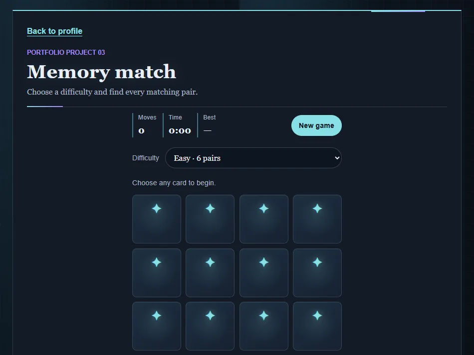

# Memory match

[Live demo](https://wjohansson94.github.io/portfolio/memory-game.html) · [Back to the main README](../../README.md)

**Authorship:** Built with AI. Made with a lot of help from an AI assistant (GitHub Copilot). I read and tested the code to understand it, but I did not write it unaided.

## What it does
A card matching game with three difficulty levels, a move counter, a timer and a personal best for each difficulty.

## How it's built
- Files: `memory-game.html`, `css/memory-game.css`, `js/memory-game.js` (plus the shared `js/theme.js` and `css/theme.css`)
- Plain HTML, CSS and JavaScript
- Game state is kept in variables; `setInterval` drives the timer and `setTimeout` handles the short delay after a mismatch
- Storage: the best score per difficulty is saved in `localStorage` (key `memoryGameBest:<difficulty>`)

## Run it locally
No install or build. Serve the repository folder, for example `python -m http.server` (or `npx serve`), and open `http://localhost:8000/memory-game.html`.

## What I understood
How game state is kept in variables, how timers (`setInterval` and `setTimeout`) work, how the cards are shuffled, and how a best score per difficulty is saved.

## What was tricky to understand
Resetting everything cleanly. Timers must be cleared on restart, and the board is locked briefly after a mismatch so a third card can't be flipped.

## Accessibility notes
Cards are real `button` elements with `aria-label`s, the difficulty select is labelled, and game messages use a polite `aria-live` status.

## Tests
No automated tests for this project.
