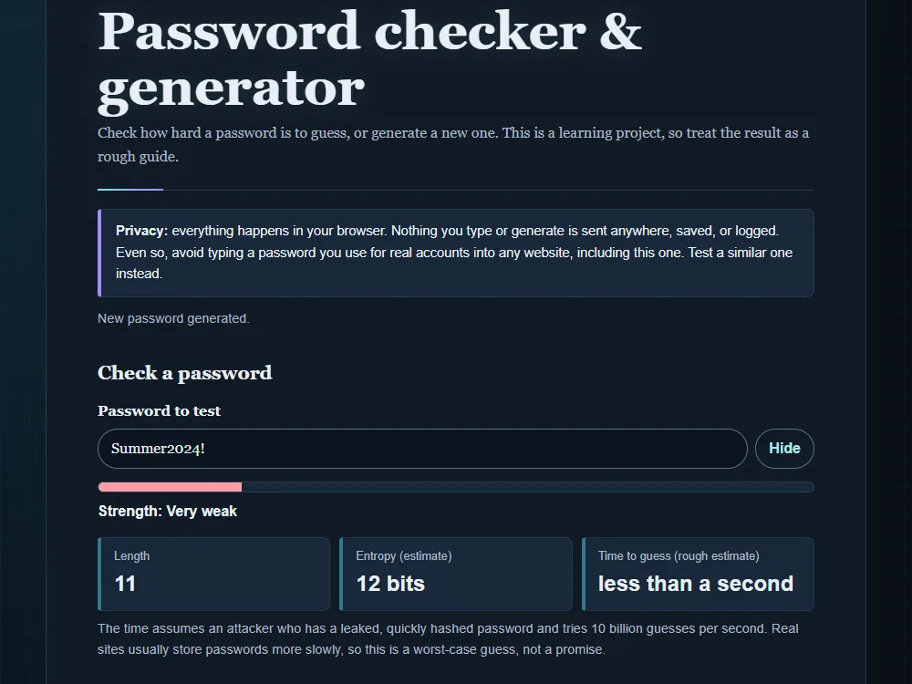

# Password checker & generator

[Live demo](https://wjohansson94.github.io/portfolio/password.html) · [Back to the main README](../../README.md)

**Authorship:** Built with AI. Made with a lot of help from an AI assistant (GitHub Copilot). I read and tested the code to understand it, but I did not write it unaided.

## What it does
Checks how strong a password looks (strength meter, entropy estimate, a rough crack-time guess and tips) and generates random passwords or passphrases. Everything runs in the browser; nothing is sent, stored or logged. The result is only an estimate: it does not check breach databases and does not recognise every dictionary word.

## How it's built
- Files: `password.html`, `css/password.css`, `js/password.js` (plus the shared `js/theme.js` and `css/theme.css`)
- Plain HTML, CSS and JavaScript
- The generator uses the Web Crypto API (`crypto.getRandomValues`, never `Math.random`) with rejection sampling to avoid bias
- The checker uses length, character variety, a small built-in common-password list and simple checks for repeats, sequences and keyboard walks
- Storage: none

## Run it locally
No install or build. Serve the repository folder, for example `python -m http.server` (or `npx serve`), and open `http://localhost:8000/password.html`.

## What I understood
Why a generator should use `crypto.getRandomValues` instead of `Math.random`, how entropy (length times the size of the character pool) gives a rough strength estimate, and how copying to the clipboard has a fallback.

## What was tricky to understand
Picking random characters fairly (a plain modulo favours some values, so the code uses rejection sampling) and pattern checks that do not count the same characters twice. The strength result is only an estimate.

## Accessibility notes
Show/hide toggle, labelled controls and `aria-live` strength announcements.

## Tests
No automated tests for this project.
