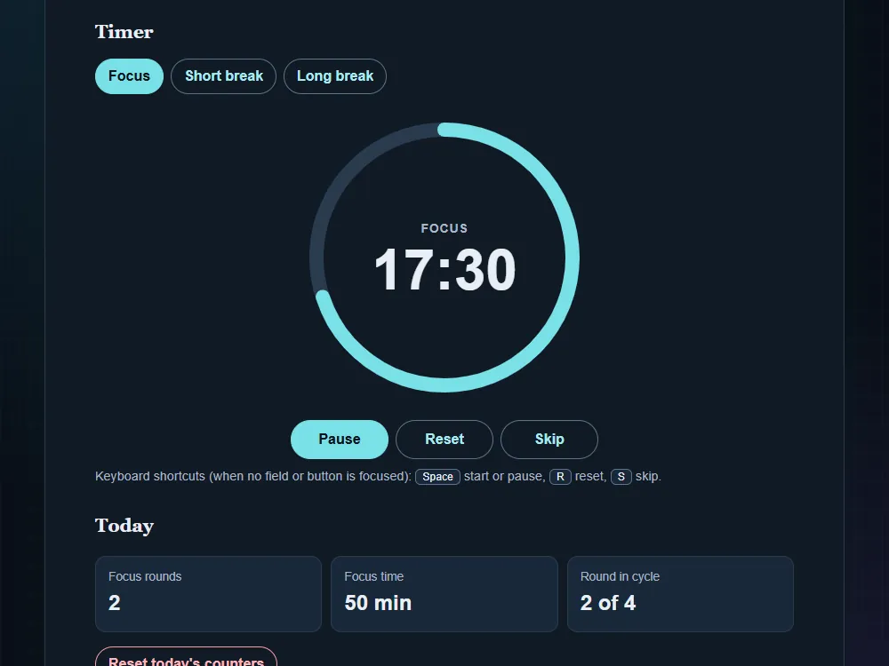

# Pomodoro timer

[Live demo](https://wjohansson94.github.io/portfolio/pomodoro.html) · [Back to the main README](../../README.md)

**Authorship:** Built with AI. Made with a lot of help from an AI assistant (GitHub Copilot). I read and tested the code to understand it, but I did not write it unaided.

## What it does
A focus and break timer with focus, short break and long break modes (defaults 25/5/15 minutes, long break after 4 focus rounds), start, pause, reset and skip, an SVG progress ring, the time left in the page title, and today's finished focus rounds and minutes. Sound and browser notifications are optional and off by default.

## How it's built
- Files: `pomodoro.html`, `pomodoro.css`, `pomodoro.js` (plus the shared `theme.js` and `theme.css`), and `tests/pomodoro.test.js`
- Plain HTML, CSS and JavaScript
- Time left is calculated from an end timestamp (`Date.now`), not by counting ticks, so it stays correct in background tabs
- The logic is kept in small pure functions that are also exported with `module.exports`, so Node can test them
- Storage: settings in `localStorage` under `pomodoro.settings` and daily stats under `pomodoro.stats`, read with `try/catch` and validated
- Optional beep with the Web Audio API (no sound files); notification permission is only requested when the box is ticked

## Run it locally
No install or build. Serve the repository folder, for example `python -m http.server` (or `npx serve`), and open `http://localhost:8000/pomodoro.html`. Keyboard shortcuts: `Space` start/pause, `R` reset, `S` skip.

## What I understood
How the time left is calculated from a stored end timestamp instead of counting ticks, how a progress ring is drawn with an SVG circle and `stroke-dashoffset`, and how the logic is kept in small pure functions that can be tested in Node. Saved settings are validated, and sound and notifications only start after a click.

## What was tricky to understand
Browsers slow down timers in background tabs, so a tick counter drifts. Using `Date.now` and recalculating when the tab becomes visible avoids that. Deciding when to announce changes to screen readers was also tricky: only mode changes are announced, not every second.

## Accessibility notes
`aria-live` announcements only when the mode changes or the timer starts or pauses, documented keyboard shortcuts, and labelled settings.

## Tests
11 tests in `tests/pomodoro.test.js` cover the pure functions: time formatting, remaining time (including a long background pause), the next mode, progress, the page title text, settings and stats validation, and adding a focus round. Run them with `node --test "tests/*.test.js"`.
