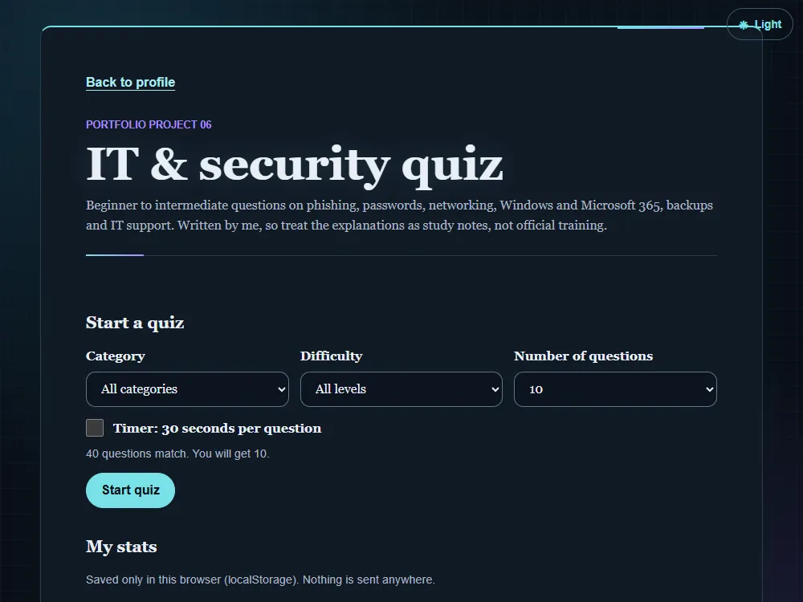

# IT & security quiz

[Live demo](https://wjohansson94.github.io/portfolio/quiz.html) · [Back to the main README](../../README.md)

**Authorship:** Built with AI. The 40 questions and explanations were created with an AI assistant and reviewed and studied by me. The code was also built with a lot of AI help. The explanations are study notes, not official training.

## What it does
A quiz with 40 beginner and intermediate questions in six categories (phishing, passwords & access, networking, Windows & Microsoft 365, data & security basics, IT support practice). You choose category, level and number of questions, answer one at a time with instant feedback and a short explanation, and see a review of wrong answers at the end. An optional 30-second timer is available.

## How it's built
- Files: `quiz.html`, `quiz.css`, `quiz.js` (plus the shared `theme.js` and `theme.css`)
- Plain HTML, CSS and JavaScript
- Questions are an array of objects; they are filtered by category and level and shuffled with the standard Fisher-Yates method
- Storage: best score and per-category stats in `localStorage` under `quizStats`, read with `try/catch` and checked for the right shape, with a reset button

## Run it locally
No install or build. Serve the repository folder, for example `python -m http.server` (or `npx serve`), and open `http://localhost:8000/quiz.html`.

## What I understood
How the questions are stored as an array of objects, how the standard Fisher-Yates method shuffles them, how they are filtered by category and level, and how stats are saved in `localStorage` after checking that the saved data has the right shape.

## What was tricky to understand
Making the quiz work with a keyboard and screen reader: radio buttons, moving focus to the feedback, and not relying on colour alone to show right and wrong answers.

## Accessibility notes
Keyboard-operable radio buttons, focus moved to the feedback, and right/wrong shown with text as well as colour.

## Tests
No automated tests for this project.
