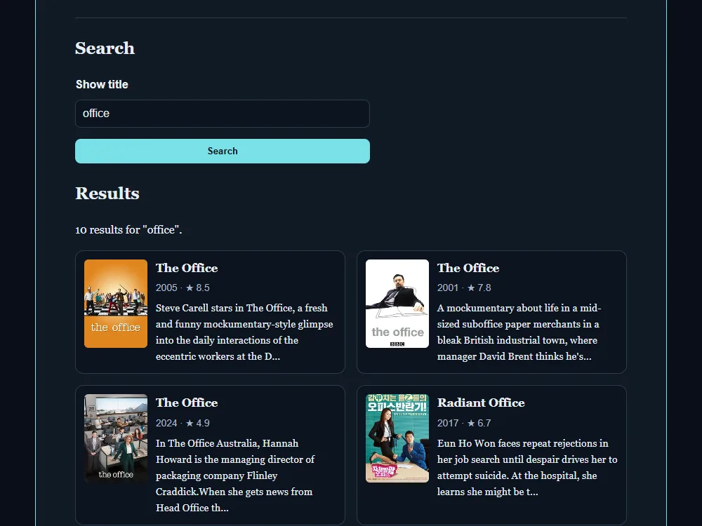

# Show search

[Live demo](https://wjohansson94.github.io/portfolio/shows.html) · [Back to the main README](../../README.md)

**Authorship:** AI-generated, typed by hand. The code was provided step by step by an AI assistant and I typed it in by hand in VS Code, then learned from it.

## What it does
Search TV shows by title. Each result shows a poster, the premiere year, the rating and a shortened summary. There are separate messages for loading, no results and errors.

## How it's built
- Files: `shows.html`, `shows.css`, `shows.js` (plus the shared `theme.js` and `theme.css`)
- Plain HTML, CSS and JavaScript, no libraries
- Data: the free [TVMaze](https://www.tvmaze.com/api) search API (`https://api.tvmaze.com/search/shows?q=`), no key needed. Nothing is stored in `localStorage`
- `async`/`await` with `fetch`; the search text is added to the URL with `encodeURIComponent`
- Results are built with `createElement` and `textContent` (not `innerHTML`); the HTML in each API summary is turned into plain text with `DOMParser`
- The data and posters come from TVMaze, so the page needs an internet connection

## Run it locally
No install or build. Serve the repository folder, for example `python -m http.server` (or `npx serve`), and open `http://localhost:8000/shows.html`. An internet connection is needed for the search.

## What I understood
How `fetch` with `async`/`await` calls a public API that needs no key, how the search text is added to the URL with `encodeURIComponent`, why results are built with `createElement` and `textContent` instead of `innerHTML`, and how the HTML in each show summary is turned into plain text with `DOMParser`. Loading, empty and error messages each get their own status text.

## What was tricky to understand
`fetch` only rejects on network problems, so a response with an error status has to be caught by checking `response.ok` and throwing an error. Both cases then end up in the same `catch` block.

## Accessibility notes
The search field has a label, the status text is a `role="status"` region so changes are announced, and posters have alt text (`Poster for <show>`).

## Tests
No automated tests for this project.
