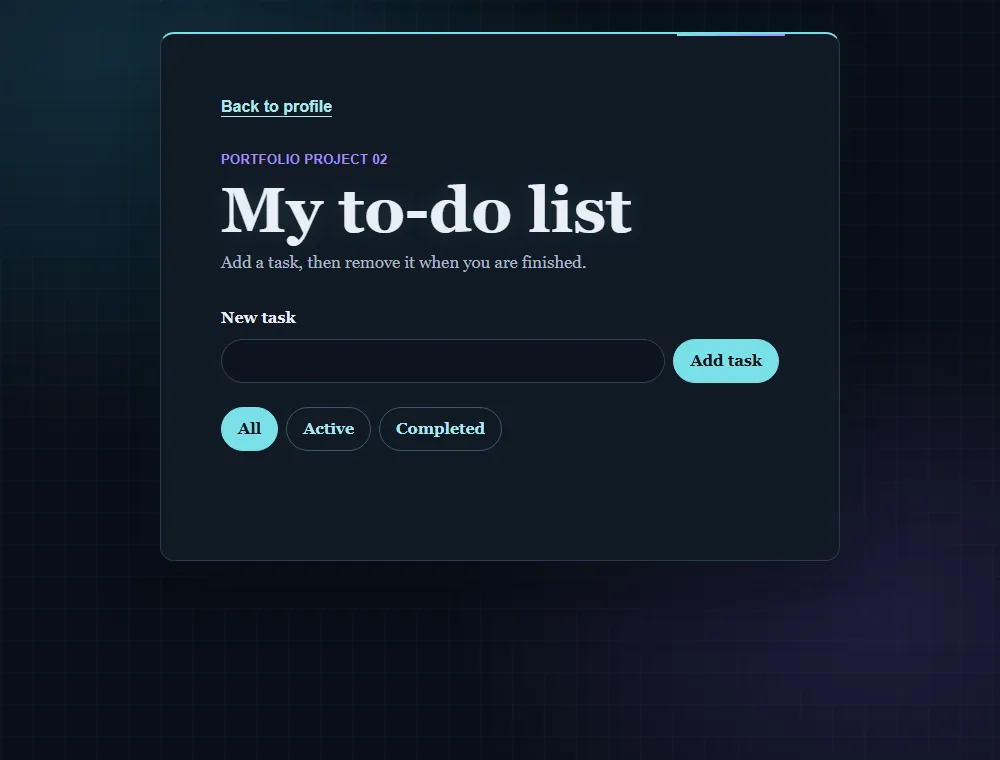

# JavaScript to-do list

[Live demo](https://wjohansson94.github.io/portfolio/todo.html) · [Back to the main README](../../README.md)

**Authorship:** Built with AI. Made with a lot of help from an AI assistant (GitHub Copilot). I read and tested the code to understand it, but I did not write it unaided.

## What it does
Add, edit, complete and delete tasks; filter, search and sort them; optional due dates with overdue highlighting. Tasks stay in the browser between visits.

## How it's built
- Files: `todo.html`, `todo.css`, `todo.js` (plus the shared `theme.js` and `theme.css`)
- Plain HTML, CSS and JavaScript
- Storage: tasks are saved as JSON in `localStorage` under `profileTasks`, and the list is rebuilt from it. Older saved tasks are converted to the newer format
- Each task keeps track of its original position so edit and delete act on the right task even when the list is filtered or sorted

## Run it locally
No install or build. Serve the repository folder, for example `python -m http.server` (or `npx serve`), and open `http://localhost:8000/todo.html`.

## What I understood
How tasks are saved as JSON in `localStorage` and the list is rebuilt from it, how older saved tasks are converted to the newer format, and how a filter, search and sort work together.

## What was tricky to understand
Edit and delete have to act on the right task even when the visible list is filtered or sorted, so each task keeps track of its original position.

## Accessibility notes
Labelled inputs and keyboard-operable buttons.

## Tests
No automated tests for this project.
