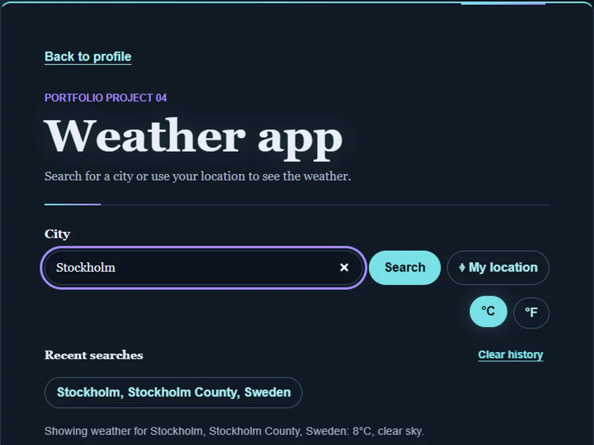

# Weather app

[Live demo](https://wjohansson94.github.io/portfolio/weather.html) · [Back to the main README](../../README.md)

**Authorship:** Built with AI. Made with a lot of help from an AI assistant (GitHub Copilot). I read and tested the code to understand it, but I did not write it unaided.

## What it does
Search for a city and see the current conditions and a 7-day forecast. It has a °C / °F toggle, a "My location" button (browser geolocation), a list of other matching places to choose from, and the last 5 searches.

## How it's built
- Files: `weather.html`, `css/weather.css`, `js/weather.js` (plus the shared `js/theme.js` and `css/theme.css`)
- Plain HTML, CSS and JavaScript with `fetch` and async/await
- Data: the free, no-key [Open-Meteo](https://open-meteo.com/) geocoding API (`geocoding-api.open-meteo.com`) and forecast API (`api.open-meteo.com`). Two calls are chained: geocoding first, then the forecast
- Weather codes are turned into readable text in the code
- Storage: search history in `localStorage` under `weatherHistory` and the chosen unit under `weatherUnit`

## Run it locally
No install or build. Serve the repository folder, for example `python -m http.server` (or `npx serve`), and open `http://localhost:8000/weather.html`. An internet connection is needed for the Open-Meteo requests.

## What I understood
How two API calls are chained (geocoding first, then the forecast), how weather codes are turned into readable text, and how `aria-live` announces results to screen readers.

## What was tricky to understand
Handling every state: loading, no match for a city, network errors, and denied location permission.

## Accessibility notes
Labelled search field, loading and error messages announced through `aria-live` regions.

## Tests
No automated tests for this project.
