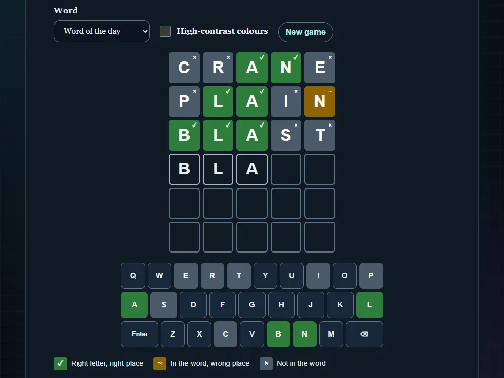

# Word guess game

[Live demo](https://wjohansson94.github.io/portfolio/wordle.html) · [Back to the main README](../../README.md)

**Authorship:** Built with AI. A small learning project made with a lot of help from an AI assistant (GitHub Copilot), not affiliated with any other game. I read and tested the code to understand it, but I did not write it unaided.

## What it does
A five-letter word guessing game with six attempts, an on-screen and physical keyboard, a win/lose dialog, a copyable emoji grid, a random word or a "word of the day" derived from the date, and saved statistics. The word lists are small, so some real words are rejected.

## How it's built
- Files: `wordle.html`, `wordle.css`, `wordle.js` (plus the shared `theme.js` and `theme.css`), and `tests/wordle.test.js`
- Plain HTML, CSS and JavaScript
- The scoring and stats logic are small pure functions, also exported with `module.exports`, so Node can test them
- The board and keyboard are built with `createElement`
- Storage: stats in `localStorage` under `wordGuess.stats` (read with `try/catch` and validated) and the high-contrast choice under `wordGuess.highContrast`
- The flip animation is skipped when `prefers-reduced-motion` is set

## Run it locally
No install or build. Serve the repository folder, for example `python -m http.server` (or `npx serve`), and open `http://localhost:8000/wordle.html`.

## What I understood
How the game logic is split into small pure functions (scoring a guess, validating saved stats) that can be tested in Node, how the board and keyboard are built with `createElement`, and how `aria-label`s and a live status message make it usable with a keyboard and screen reader.

## What was tricky to understand
Marking repeated letters correctly (a letter can only be yellow as many times as it is still unused in the answer) and stopping the physical Enter key from also pressing a focused on-screen button.

## Accessibility notes
Every tile state has a symbol and an `aria-label`, not only a colour; there is an optional high-contrast mode; results and invalid-word messages are announced through an `aria-live` region.

## Tests
11 tests in `tests/wordle.test.js` cover scoring (including repeated letters), keeping the best keyboard state, the word lists, the word of the day, stats validation and updates, and the share text. Run them with `node --test "tests/*.test.js"`.
